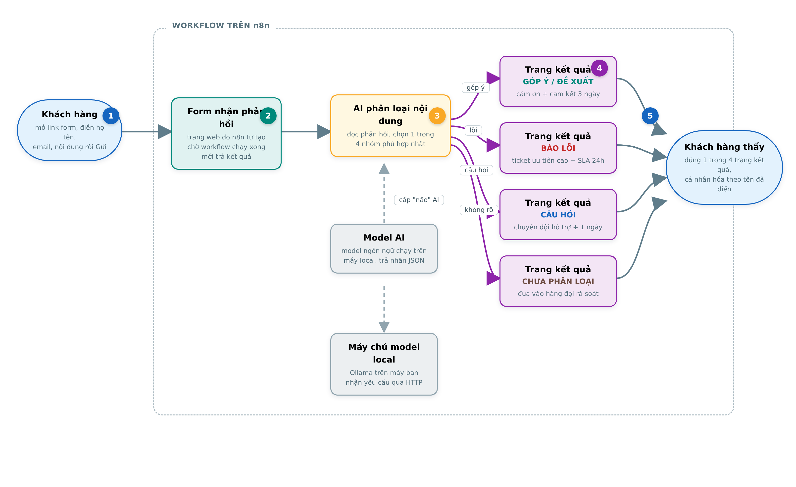

# n8n-feedback-classifier

Phân loại phản hồi khách hàng tự động bằng AI trong n8n - nhận form web, phân loại
thành **góp ý / báo lỗi / câu hỏi** (hoặc *không rõ*), rồi trả trang kết quả ngay
trên trình duyệt. Không cần webhook ngoài, không cần dịch vụ form bên thứ ba.



## Cấu trúc

```
workflows/
  feedback-classifier-ollama.workflow.json   # workflow chính, model local qua Ollama
  feedback-classifier-openai.workflow.json   # biến thể dùng OpenAI gpt-4o-mini
scripts/
  bench_classifier.py                        # benchmark độ chính xác + độ trễ model
  bench_results.json                         # kết quả đo thực tế
test/
  test-cases.md                              # 10 phản hồi kiểm thử + kết quả chạy
docs/
  architecture.png                           # sơ đồ luồng xử lý
  screenshots/                               # ảnh chụp UI thật (form, kết quả, editor)
```

## Cài đặt

```bash
# 1. Ollama + cau hinh bind cong tren Linux
curl -fsSL https://ollama.com/install.sh | sh

# Cau hinh OLLAMA_HOST de container Docker ket noi duoc qua bridge
sudo mkdir -p /etc/systemd/system/ollama.service.d
echo -e "[Service]\nEnvironment=\"OLLAMA_HOST=0.0.0.0:11434\"" | sudo tee /etc/systemd/system/ollama.service.d/environment.conf
sudo systemctl daemon-reload && sudo systemctl restart ollama

# Pull model
ollama pull qwen3:4b-instruct

# 2. n8n
docker run -d --name n8n -p 5678:5678 \
  --add-host=host.docker.internal:host-gateway \
  -v n8n_data:/home/node/.n8n n8nio/n8n:latest
```

## Sử dụng

1. Mở `http://localhost:5678`, tạo tài khoản admin (lần đầu).
2. **New workflow** → menu **...** → **Import** → chọn
   `workflows/feedback-classifier-ollama.workflow.json`.
3. Mở node **Ollama Chat Model**, tạo credential trỏ tới:
   - `http://localhost:11434` nếu n8n cài trực tiếp trên máy
   - `http://host.docker.internal:11434` nếu n8n chạy trong Docker
4. Bấm **Publish**, mở `http://localhost:5678/form/phan-hoi-khach-hang`.

Khách điền form → AI phân loại → trang kết quả căn giữa màn hình hiển thị đúng
nhóm kèm tên khách và thông báo phân loại thực tế.

| Nhánh | Trang kết quả |
|---|---|
| Góp ý | Xác nhận phân loại là Góp ý / Đề xuất cải tiến |
| Báo lỗi | Xác nhận phân loại là Báo lỗi hệ thống |
| Câu hỏi | Xác nhận phân loại là Câu hỏi cần giải đáp |
| Không rõ | Xác nhận phân loại là Chưa xác định (chờ rà soát) |

## Kiểm thử bằng curl

Form nhận multipart (`-F`), không nhận urlencoded:

```bash
curl -F 'field-0=Nguyễn Văn An' -F 'field-1=an@example.com' \
  -F 'field-2=Khi thanh toán bằng MoMo trang báo lỗi 500' \
  http://localhost:5678/form/phan-hoi-khach-hang
```

## Benchmark

```bash
python3 scripts/bench_classifier.py
```

| Model | Đúng/10 mẫu | Độ trễ trung vị |
|---|---|---|
| qwen2.5:7b | 10/10 | ~0,4 s |
| tinix-lm | 9/10 | ~0,12 s |
| qwen3:4b-instruct | 9/10 | ~1,5 s |

## Lưu ý

- `ignoreBots: true` sẽ chặn curl/headless (HTTP 401) - để `false` khi test tự động.
- Lần gọi model đầu chậm 30-50 s (nạp model vào bộ nhớ).
- Test URL chỉ sống trong phiên soạn workflow; production phải Publish.

## License

MIT
